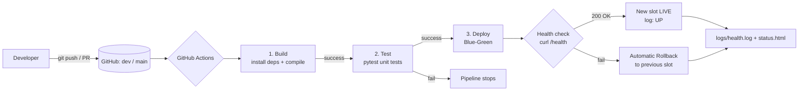
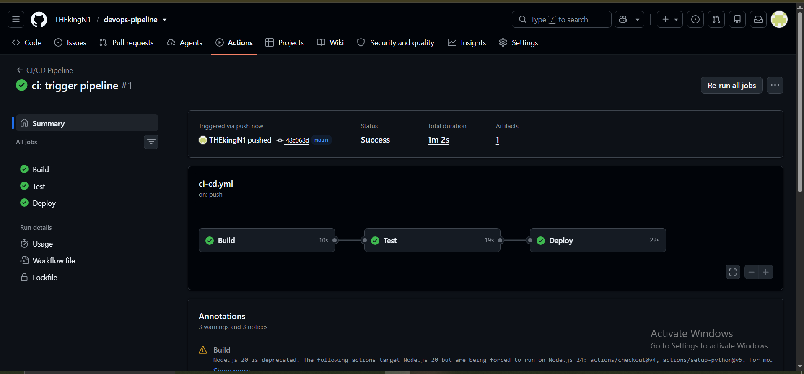
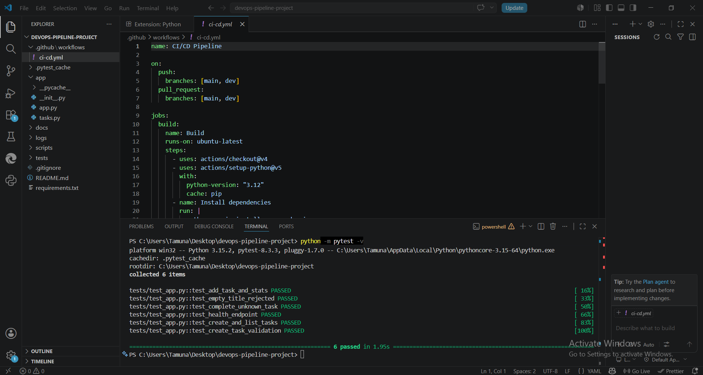
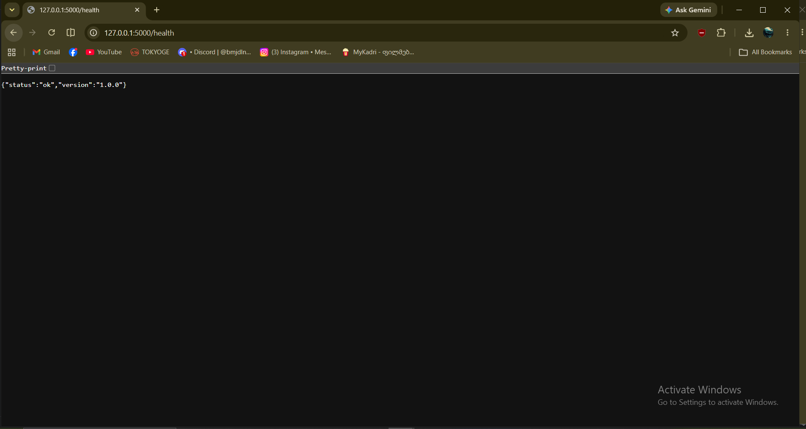

# Task Tracker – DevOps Pipeline (შუალედური პროექტი)

## 1. პროექტის აღწერა

**Task Tracker** არის მარტივი REST API (Python + Flask), რომლითაც შეიძლება დავალებების დამატება, სიის ნახვა, დასრულებულად მონიშვნა და სტატისტიკის მიღება. პროექტის მთავარი აქცენტია არა აპლიკაცია, არამედ მის გარშემო აწყობილი სრული ავტომატიზაციის ჯაჭვი (CI/CD).

| Endpoint | აღწერა |
|---|---|
| `GET /health` | ჯანმრთელობის შემოწმება (`{"status":"ok"}`) |
| `GET /tasks`, `POST /tasks` | დავალებების სია / დამატება |
| `POST /tasks/<id>/done` | დავალების დასრულება |
| `GET /stats` | სტატისტიკა (სულ / დასრულებული / დარჩენილი) |

**გამოყენებული ინსტრუმენტები:** Python 3.12, Flask, pytest, Git + GitHub, GitHub Actions, Bash (deploy / rollback / health-check სკრიპტები), curl.

## 2. პროექტის სტრუქტურა

```
├── app/                    # აპლიკაცია (app.py – Flask, tasks.py – ბიზნეს ლოგიკა)
├── tests/test_app.py       # 6 unit ტესტი (pytest)
├── scripts/
│   ├── deploy.sh           # Blue-Green დეპლოი + ავტომატური rollback
│   ├── rollback.sh         # ხელით rollback წინა ვერსიაზე
│   ├── health_check.sh     # curl შემოწმება + ჩაწერა logs/health.log-ში
│   └── status_dashboard.py # (ბონუსი) ვიზუალური status.html
├── .github/workflows/ci-cd.yml
├── logs/health.log         # მონიტორინგის ლოგი
└── requirements.txt
```

## 3. Git სამუშაო პროცესი

- ორი ბრენჩი: **`dev`** (ყოველდღიური განვითარება) და **`main`** (სტაბილური ვერსია).
- ცვლილებები ჯერ `dev`-ში ხვდება, პაიპლაინის წარმატების შემდეგ ხდება Pull Request `dev → main`.
- Commit შეტყობინებები: `feat:`, `test:`, `ci:`, `docs:`, `fix:` პრეფიქსებით.

## 4. CI/CD პროცესის ახსნა

Workflow ფაილი: [`.github/workflows/ci-cd.yml`](.github/workflows/ci-cd.yml).
**ტრიგერი:** ყოველი `push` და `pull_request` ბრენჩებზე `main` და `dev`.

| # | Job | რას აკეთებს |
|---|---|---|
| 1 | **Build** | ამზადებს გარემოს (Python 3.12), აინსტალირებს დამოკიდებულებებს (`pip install -r requirements.txt`) და ამოწმებს, რომ კოდი კომპილირდება (`compileall`). |
| 2 | **Test** (`needs: build`) | უშვებს ყველა unit ტესტს: `python -m pytest -v`. ჩავარდნისას პაიპლაინი ჩერდება და დეპლოი არ სრულდება. |
| 3 | **Deploy** (`needs: test`, მხოლოდ `push`-ზე) | უშვებს `scripts/deploy.sh`-ს (Blue-Green), შემდეგ health check-ს, აგენერირებს status dashboard-ს და ტვირთავს ლოგებს artifact-ად. |

### დეპლოიმენტი – გზა ა (ლოკალური Blue-Green + Rollback)

1. `production/` საქაღალდეში არსებობს ორი slot: `blue` და `green`. აქტიური slot ინახება `production/active_slot`-ში.
2. ახალი ვერსია იკოპირება **უმოქმედო** slot-ში.
3. სერვერი გადაირთვება ახალ slot-ზე და სრულდება health check (`curl /health`, 10 მცდელობა).
4. წარმატების შემთხვევაში `production/current` symlink გადადის ახალ slot-ზე და ის ხდება აქტიური.
5. **Rollback (ბონუსი, ავტომატური):** თუ health check ჩავარდა, `deploy.sh` ავტომატურად აბრუნებს წინა სამუშაო slot-ს, წერს `DEPLOY_FAILED` ჩანაწერს ლოგში და სრულდება კოდით `1` (ანუ პაიპლაინი წითლდება, მაგრამ სერვისი არ ითიშება).
6. ხელით rollback: `bash scripts/rollback.sh`.

> ლოკალური გატესტვა ორმაგად გამოიცადა: წარმატებული დეპლოი blue→green→blue, ჩავარდნილი დეპლოი (გატეხილი `/health`) → ავტომატური დაბრუნება წინა slot-ზე, და ხელით rollback.

## 5. მონიტორინგი და Health Check

- `scripts/health_check.sh [URL]` აგზავნის `curl` მოთხოვნას, ამოწმებს HTTP სტატუსს (200 = `UP`, სხვა = `DOWN`) და ამატებს ჩანაწერს `logs/health.log`-ში:
  ```
  2026-11-03T18:23:14Z UP url=http://127.0.0.1:5000/health http=200
  ```
- **ბონუსი – ვიზუალური დეშბორდი:** `python scripts/status_dashboard.py` ქმნის `status.html`-ს (მწვანე/წითელი ინდიკატორი + ბოლო 30 შემოწმება).

## 6. Workflow დიაგრამა



## 7. სქრინშოტები

### 7.1 წარმატებით გავლილი 3-საფეხურიანი GitHub Actions პაიპლაინი

*Actions ტაბი: Build → Test → Deploy სამივე job მწვანეა.*

### 7.2 წარმატებული unit ტესტები

*`pytest -v` – 6 ტესტი გავიდა (`6 passed`).*

### 7.3 მომუშავე აპლიკაცია

*`http://127.0.0.1:5000/health` ბრაუზერში / `curl`-ით პასუხი `{"status":"ok"}`.*

## 8. ლოკალურად გაშვება

```bash
pip install -r requirements.txt
python -m pytest -v          # ტესტები
bash scripts/deploy.sh       # დეპლოი production/ საქაღალდეში
bash scripts/health_check.sh # შემოწმება
python scripts/status_dashboard.py
```
